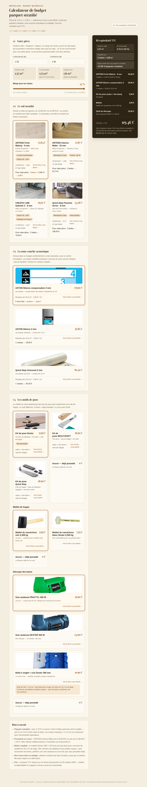

# Calculateur de budget parquet — Leroy Merlin

Calculateur web interactif pour estimer le budget d'un **parquet stratifié** posé dans une petite pièce (par défaut **1,52 m × 1,56 m**, soit 2,37 m² net), à partir de références et de prix réels relevés sur [leroymerlin.fr](https://www.leroymerlin.fr) le **25 octobre 2026**. Tous les montants sont affichés en TTC.

## Fonctionnalités

- **Surface** : dimensions de la pièce modifiables, surface nette calculée automatiquement.
- **Marge de chutes** : curseur de 10 % à 15 % (15 % conseillé pour une petite pièce).
- **Achat par conditionnements complets** : le nombre de bottes de stratifié et de rouleaux de sous-couche est arrondi au conditionnement supérieur, et la *marge réelle* due aux paquets complets est affichée.
- **4 sols stratifiés** de 13,99 €/m² à 24,99 €/m² (entrée à milieu de gamme), avec prix par botte et surface par botte.
- **3 sous-couches acoustiques** (rouleaux de 10 à 15 m²).
- **Outillage** : kits de pose (cales + tire-lame + cale de frappe), maillets, scies sauteuses et boîte à onglets — chaque poste peut être marqué « déjà possédé ».
- **Récapitulatif TTC** détaillé poste par poste, avec total et coût au m² de surface nette.

## Exemple de budget par défaut

| Poste | Référence | Coût TTC |
|---|---|---|
| Stratifié (2 bottes = 3,98 m²) | ARTENS Forte Maleny 8 mm — 13,99 €/m² | 55,68 € |
| Sous-couche acoustique (1 rouleau 10 m²) | AXTON Silence compensation 3 mm | 29,90 € |
| Kit de pose | Kit Dexter | 9,99 € |
| Maillet | Caoutchouc noir 0,308 kg | 3,99 € |
| Scie sauteuse | PRACTYL 400 W | 19,90 € |
| **Total TTC** | | **119,46 €** |

## Utilisation

Aucune installation ni dépendance : ouvrez simplement `index.html` dans un navigateur. Le fichier est autonome (HTML + CSS + JS dans un seul fichier, polices chargées via CDN Fontshare).

## Structure du code

Tout le code tient dans [`index.html`](index.html) :

- **Catalogue produits** : les tableaux `FLOORINGS`, `UNDERLAYS`, `KITS`, `MALLETS` et `CUTS` en tête du script contiennent les 12 références vérifiées (prix, conditionnement, lien vers la fiche produit Leroy Merlin). Mettez-les à jour si les prix évoluent.
- **Photos produits** : chaque référence possède une photo officielle dans le dossier [`assets/`](assets/) (images Leroy Merlin, CDN media.adeo.com), affichée en haut de sa carte pour identifier le produit d'un coup d'œil.
- **Logique de calcul** : la fonction `compute()` (arrondi au conditionnement supérieur via `Math.ceil`) et `render()` (mise à jour du récapitulatif).
- **Avertissement découpe** : la boîte à onglets (285 × 110 mm) est signalée comme trop étroite pour couper des lames de 19,2 cm de large — réservée aux plinthes et petites coupes.

## Sources et limites

- Prix TTC relevés sur les fiches produits leroymerlin.fr le 25/10/2026 (dont une promo ARTENS Intenso Malte à 16,50 €/m² au lieu de 21,99 €/m², valable jusqu'au 3 novembre). Les prix, promotions et disponibilités évoluent : vérifiez les fiches avant tout achat.
- Non inclus : plinthes et barres de seuil, livraison, pose par un artisan, film pare-vapeur sur dalle béton.

Projet personnel à but indicatif — sans affiliation avec Leroy Merlin.
